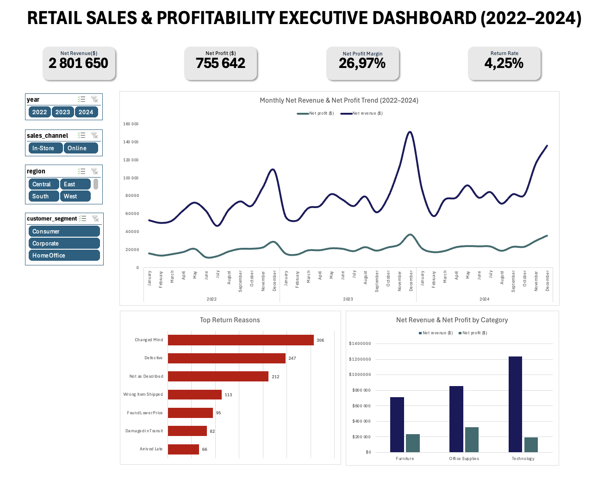
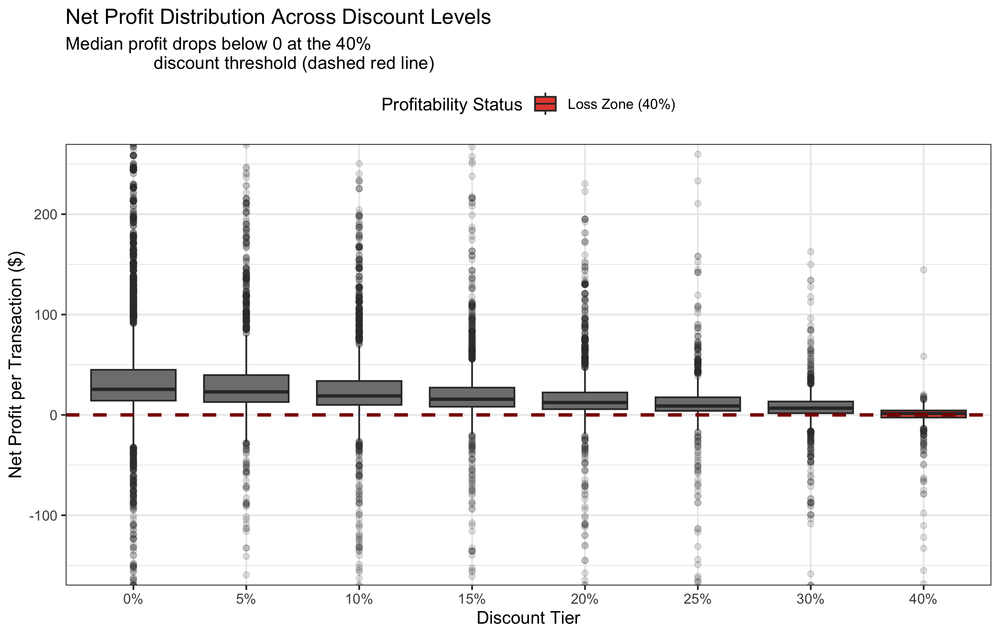
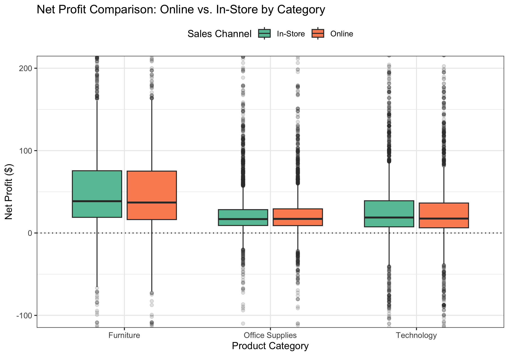
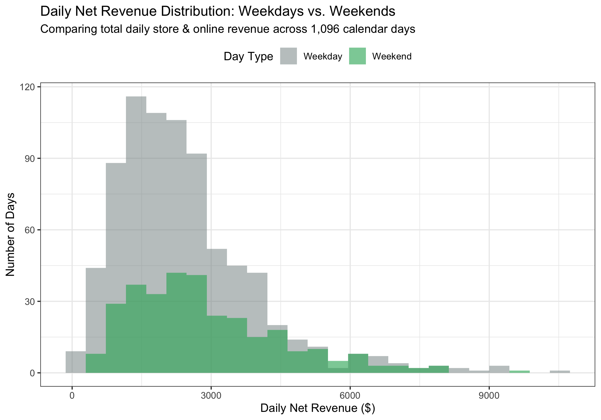

# End-to-End Retail Sales & Profitability Analysis (2022–2024)

## Project Overview & Business Problem

Analyzing **26,385 Online and In-Store retail transactions** ($2.80M net revenue, $755.6K net profit), this project investigates why net margins declined despite steady top-line growth. Through a full analytical workflow in **PostgreSQL** (ETL, RFM segmentation), **R** (hypothesis testing, regression, `ggplot2`), and **Excel** (executive dashboard, What-If Scenario Manager), it isolates toxic discount tiers and return drivers while quantifying the net profit gain from targeted policy changes.

## Executive Dashboard 

*(Interactive dashboard featuring dynamic KPI cards, monthly revenue/profit trends, category profitability, return diagnostics, and cross-filtered slicers).*

---

## Key Analytical Findings

### 1. Diagnostics & Customer Segmentation (PostgreSQL)
Diagnostic queries revealed a sharp profitability gap across product categories: while *Technology* generates the highest net sales ($1.24M), it suffers from the lowest net margin (**15.70%**) due to a **5.99%** return rate—led by brand *Arclight* at **4.00%** quality-related returns—whereas *Office Supplies* achieves a **38.32%** net margin. Examining discount tiers exposed a clear margin trap at the 40% level, where 453 orders generated a net loss of **-$1,256.26** (-3.82% margin) even though average basket size remained flat (~2.62 items) across all tiers. Furthermore, Online orders exhibited nearly double the return rate of In-Store purchases (**5.98% vs. 3.09%**), resulting in **$74,276** in lost revenue from online refunds. Finally, RFM segmentation identified **437 Champions** driving **$1.28M** in revenue (avg. LTV $2,929) alongside **299 At-Risk high-value customers** (avg. LTV $1,696) requiring targeted retention campaigns.

### 2. Statistical Hypothesis Testing (R)
Statistical validation in R confirmed that deeper discounts do not drive larger order volumes, showing near-zero Pearson correlation between discount depth and quantity purchased (*r* = 0.0025, *p* = 0.681), while OLS regression proved that every 10% increase in discount erodes transaction net profit by **$11.78** (*p* < 0.001). Welch’s two-sample t-test further demonstrated that In-Store net profit margin (**32.84%**) is significantly higher than Online (**29.48%**, *t* = 10.91, *p* < 0.001), and daily revenue analysis confirmed that weekend performance outpaces weekdays by **19.3%** ($2,892 vs. $2,424/day, *t* = -4.37, *p* < 0.001).

---

## Business Recommendations & Financial Impact (What-If Model)
Using Excel's **Scenario Manager**, three policy scenarios were modeled against the baseline net profit of **$755,642** to quantify the financial upside of targeted operational changes. Under a **Moderate Reform** scenario (25% margin recovery on high-discount tiers combined with a 15% reduction in product defect rates), projected net profit rises to **$763,425**, generating **+$7,782** in incremental gain. Adopting the **Target Policy**—which caps promotional discounts at 25% to eliminate the loss-making 40% tier, reallocates marketing spend toward *At-Risk* RFM customers, and enforces supplier quality audits for high-return *Technology* brands alongside a 20% defect reduction—increases projected net profit to **$767,473**, delivering **+$11,831** in incremental net profit over the baseline period.

---

## Repository Structure
- **SQL & Data:** [`retail_sales_tables.sql`](retail_sales_tables.sql) (normalized 6-table schema, ETL cleaning scripts, and analytical `VIEW`), [`business_quiries.sql`](business_quiries.sql) (RFM segmentation and profitability queries), and [`v_clean_sales_summy.csv`](v_clean_sales_summy.csv) (clean analytical dataset).
- **R Statistical Analysis:** [`statistical_analysis.R`](statistical_analysis.R) (hypothesis testing using `t-test`, `Wilcoxon`, `lm`, and `ggplot2` visualizations), along with exported charts [`01_discount_profit_boxplot.png`](01_discount_profit_boxplot.png), [`02_channel_profit_comparison.png`](02_channel_profit_comparison.png), and [`03_daily_revenue_weekend_vs_weekday.png`](03_daily_revenue_weekend_vs_weekday.png).
- **Excel Dashboard & Modeling:** [`project summary.xlsx`](<project summary.xlsx>) (interactive Executive Dashboard, Pivot Tables, Slicers, `What-If_Model`, and `Scenario Summary`) and [`dashboard_preview.png`](dashboard_preview.png).
